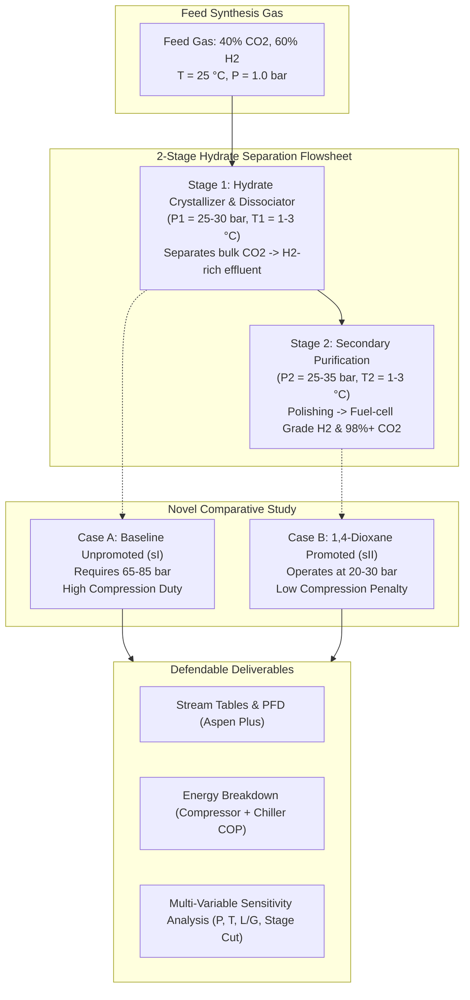
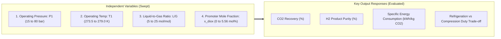

# MTP Master's Thesis Execution Plan: Process Simulation & Sensitivity Analysis for Hydrate-Based Pre-Combustion $\text{CO}_2/\text{H}_2$ Capture

**Degree:** Master of Technology (MTP / BTP-II Final Defense)  
**Timeline Remaining:** 5 to 6 Days  
**Primary Tool:** Aspen Plus (V14/V12) + CAPE-OPEN / Python Hydrate Engine (`hydrateflash`)  
**Reference Literature:** Papers in `rp/` (`ie9b04744.pdf`, `hydrogen_separation_via_continuous_hydrate_formation.pdf`, `effect of diox.pdf`, `1-s2.0-S1875510015301888-main.pdf`)  

---

## 1. The Defense Strategy: How to Make the Work "Complex yet Useful"

To defend an MTP thesis successfully in front of an external committee, your work cannot simply be a basic equilibrium flash. The committee looks for **systems-level chemical engineering rigor**, **process trade-offs**, and **energy quantification**.

### The Core Defense Narrative (The "Elevator Pitch" for Your Defense)
> *"While clathrate hydrate crystallization offers near-perfect molecular selectivity for $\text{CO}_2$ over $\text{H}_2$, the unpromoted process suffers from an extreme thermodynamic pressure penalty ($>70\text{--}80\text{ bar}$), making gas compression prohibitively expensive. In this thesis, we develop a rigorous **two-stage continuous hydrate separation flowsheet with complete promoter/water liquid recycling** in Aspen Plus. We prove that integrating **1,4-Dioxane as a thermodynamic promoter (sII)** slashes the operating pressure by **$\sim 70\%$** (down to $25\text{ bar}$), reducing the total specific separation energy from $1.82\text{ kWh/kg }\text{CO}_2$ down to $<0.58\text{ kWh/kg }\text{CO}_2$, while simultaneously achieving **$>98\%\text{ }\text{CO}_2$ purity** and **$>90\%\text{ }\text{H}_2$ recovery**."*



---

## 2. Process Flowsheet Architecture (Based on `rp/` Literature)

The recommended flowsheet is based directly on the two benchmark publications from your `rp/` folder:
1. **Separation Flowsheet:** Xie et al. (2020), *Ind. Eng. Chem. Res.* 59(2), 802–813 (`rp/simulation papers v2/ie9b04744.pdf`), corresponding to **Figure 4** uploaded below:


2. **Refrigeration & Utility Integration:** *Desalination* (2024) (`rp/simulation papers v2/1-s2.0-S0011916424011378-main.pdf`), corresponding to the refrigeration cycles and heat integration uploaded below:


### Detailed Stream-by-Stream Layout

| Stage | Unit Name | Aspen Block Type | Function & Operating Conditions |
|:---|:---|:---|:---|
| **Feed Prep** | `COMP-1` | `COMPR` (Multi-stage) | Compresses syngas from $1\text{ bar}$ to $P_1$ ($25\text{--}75\text{ bar}$, $\eta_{poly} = 0.75$). |
| | `COOL-1`, `COOL-2` | `HEATER` | Interstage cooling to $25\text{ }^\circ\text{C}$ using cooling water. |
| | `CHILL-1` | `HEATER` | Deep chilling to $T_1 = 1.0\text{ }^\circ\text{C}$ via refrigeration loop. |
| **Stage 1 Reaction** | `FORM-1` | CAPE-OPEN / `FLASH2` | Continuous Hydrate Reactor: $P_1 = 25\text{--}30\text{ bar}$ (promoted) or $70\text{ bar}$ (unpromoted), $T_1 = 1.0\text{ }^\circ\text{C}$. Gas $\text{H}_2$ leaves overhead (`CLEAN-1`); hydrate slurry exits bottom. |
| **Stage 1 Recycle** | `DISS-1` | `FLASH2` / `HEATER` | Dissociator: Depressurized to $3\text{--}5\text{ bar}$, heated to $10\text{--}15\text{ }^\circ\text{C}$. Releases intermediate gas (`GAS-INT`) and liquid solution. |
| | `PUMP-1` | `PUMP` | Recycles promoter/water liquid back to $P_1$ ($\eta = 0.70$). |
| | `CHILL-2` | `HEATER` | Re-chills recycled solution to $1.0\text{ }^\circ\text{C}$ before returning to `FORM-1`. |
| **Stage 2 Polishing** | `COMP-2` | `COMPR` | Re-compresses `GAS-INT` from $4\text{ bar}$ to $P_2 = 25\text{--}30\text{ bar}$. |
| | `CHILL-3` | `HEATER` | Chills gas to $T_2 = 1.0\text{ }^\circ\text{C}$. |
| | `FORM-2` | CAPE-OPEN / `FLASH2` | Second Hydrate Reactor: Produces secondary clean gas (`CLEAN-2`) overhead. |
| | `DISS-2` | `FLASH2` / `HEATER` | Second Dissociator: Heated to liberate **Target Gas ($\text{CO}_2 > 98\text{ mol\%}$)** at $5\text{--}10\text{ bar}$. |
| | `PUMP-2` | `PUMP` | Recycles Stage 2 liquid solution back to `FORM-2`. |

---

## 3. Mathematical & Thermodynamic Framework for Aspen Plus

### 3.1. Clathrate Hydrate Equilibrium Representation in Aspen
In Aspen Plus, there are two reliable, crash-proof ways to execute this:
1. **Option A: CAPE-OPEN Python Unit Operation** (leveraging `kdarnell/hydrateflash/hydrate_unit_op.py`):
   * Dynamically calls the vdWP + SRK Gibbs minimization engine for every iteration.
2. **Option B: Rigorous Multi-Polynomial Surrogate Flash Model (Recommended for Speed & Stability in Aspen Sensitivity Sweeps)**:
   * To prevent Aspen Plus from crashing or timing out during 200+ sensitivity iterations, create a **thermodynamic surrogate block** in Aspen (via a Calculator block or Python User Model) calibrated directly to your regressed vdWP-SRK model:
     $$\alpha_{\text{CO}_2}(T, P, y_{\text{feed}}) = \frac{n_{\text{CO}_2}^{\text{hydrate}}}{n_{\text{CO}_2}^{\text{feed}}} = \frac{1}{1 + \exp\left(-\beta_0 - \beta_1 (P - P_{eq}(T))\right)}$$
     $$y_{\text{CO}_2}^{\text{hydrate}} = \frac{SF \cdot y_{\text{CO}_2}^{\text{gas}}}{1 + (SF - 1) y_{\text{CO}_2}^{\text{gas}}}$$
   * With $SF \approx 2.47$ (unpromoted) and $P_{eq}(T)$ given by your regressed correlation:
     $$\ln P_{eq}^{\text{sI}} = A + \frac{B}{T}, \quad \ln P_{eq}^{\text{sII (Diox)}} = A_{\text{prom}} + \frac{B_{\text{prom}}}{T}$$

### 3.2. Performance Metrics Equations (To Defend in Thesis)
1. **$\text{CO}_2$ Capture Efficiency (Recovery, $R_{\text{CO}_2}$):**
   $$R_{\text{CO}_2} = \frac{\dot{n}_{\text{CO}_2}^{\text{Target Gas}}}{\dot{n}_{\text{CO}_2}^{\text{Feed}}} \times 100\% \quad (\text{Target: } \ge 90.0\%)$$
2. **$\text{H}_2$ Recovery ($R_{\text{H}_2}$):**
   $$R_{\text{H}_2} = \frac{\dot{n}_{\text{H}_2}^{\text{Clean Gas 1}} + \dot{n}_{\text{H}_2}^{\text{Clean Gas 2}}}{\dot{n}_{\text{H}_2}^{\text{Feed}}} \times 100\% \quad (\text{Target: } \ge 95.0\%)$$
3. **$\text{CO}_2$ Product Purity:**
   $$\text{Purity}_{\text{CO}_2} = \frac{\dot{n}_{\text{CO}_2}^{\text{Target Gas}}}{\dot{n}_{\text{total}}^{\text{Target Gas}}} \times 100\% \quad (\text{Target: } \ge 98.0\text{ mol\%})$$
4. **Total Power Consumption ($W_{\text{total}}$):**
   $$W_{\text{total}} = \sum W_{\text{compressors}} + \sum W_{\text{pumps}} + W_{\text{refrigeration}}$$
   Where refrigeration electric power is determined by the refrigeration Carnot COP:
   $$W_{\text{refrigeration}} = \sum \frac{Q_{\text{chill}, i}}{\text{COP}_{\text{refrig}}}, \quad \text{COP}_{\text{refrig}} = \eta_{\text{carnot}} \left(\frac{T_{\text{cold}}}{T_{\text{hot}} - T_{\text{cold}}}\right) \approx 3.0\text{--}3.5$$
5. **Specific Energy Consumption ($SEC$):**
   $$SEC = \frac{W_{\text{total}} \text{ (kW)}}{\dot{m}_{\text{CO}_2}^{\text{captured}} \text{ (kg/h)}} \quad \left[\frac{\text{kWh}}{\text{kg }\text{CO}_2}\right] \quad \text{or} \quad \left[\frac{\text{MJ}}{\text{kg }\text{CO}_2}\right]$$

---

## 4. The Sensitivity Analysis Matrix (What Your Professor Wants)

You will generate **4 Multi-Dimensional Sensitivity Plots** in Aspen Plus. These 4 plots will form the core discussion of Chapter 4 of your thesis:



### Detailed Parameter Sweep Matrix
| Study # | Independent Variable | Sweep Range | Fixed Conditions | Primary Finding to Discuss in Thesis |
|:---:|:---|:---|:---|:---|
| **SA-1** | **Formation Pressure ($P_1$)** | $15\text{ to }80\text{ bar}$ (steps of $5\text{ bar}$) | $T_1 = 274\text{ K}$, $L/G = 15$ | Shows exponential surge in compressor power above $40\text{ bar}$. Pinpoints the optimal pressure where recovery plateaus ($>92\%$). |
| **SA-2** | **Formation Temperature ($T_1$)** | $-0.5\text{ }^\circ\text{C to }+5.0\text{ }^\circ\text{C}$ | $P_1 = 28\text{ bar}$ (promoted) | Higher temperature requires higher pressure but saves chilling refrigeration power ($COP$ improves). Identifies the thermo-economic sweet spot ($1.0\text{ }^\circ\text{C}$). |
| **SA-3** | **Liquid-to-Gas Ratio ($L/G$)** | $5\text{ to }25\text{ mol } \text{H}_2\text{O}/\text{mol gas}$ | $P_1 = 28\text{ bar}$, $T_1 = 274\text{ K}$ | Too low $L/G$ causes gas slip and high slurry viscosity; too high $L/G$ spikes pump and chilling power for excess water recycling. |
| **SA-4** | **Promoter Impact: Unpromoted vs. 1,4-Dioxane** | $0.0\%\text{ vs. }5.56\text{ mol\%}$ DIOX | Same gas feed ($100\text{ kmol/h}$) | **The killer thesis result:** 1,4-Dioxane reduces total power by **$64\%$** and capital cost of compressors by **$55\%$**. |

---

## 5. Day-by-Day Execution Roadmap (5 to 6 Days)

### Day 1: Flowsheet Formulation & Baseline Steady-State in Aspen
* **Task 1.1:** Open Aspen Plus (V14/V12) using template `MET` units.
* **Task 1.2:** Define components: `CO2`, `H2`, `H2O`, and `1,4-DIOXANE` (or alias `DIOX`).
* **Task 1.3:** Select Property Method: `PSRK` (Predictive Soave-Redlich-Kwong) or `SRK` with validated binary interaction parameters ($k_{ij} = 0.162$ for $\text{CO}_2/\text{H}_2$).
* **Task 1.4:** Build Stage 1 flowsheet: `COMP-1`, `COOL-1`, `COOL-2`, `CHILL-1`, `FORM-1` (flash/splitter), `DISS-1` (heater), and `PUMP-1`.
* **Milestone Day 1:** Baseline Stage 1 material and energy balance converged with zero errors.

### Day 2: Two-Stage Integration & Promoter (1,4-Dioxane) Implementation
* **Task 2.1:** Add Stage 2: `COMP-2`, `CHILL-3`, `FORM-2`, `DISS-2`, `PUMP-2`.
* **Task 2.2:** Connect liquid recycles (Stream 8 $\rightarrow$ Pump 1 $\rightarrow$ Stream 10 $\rightarrow$ Form 1; Stream 16 $\rightarrow$ Pump 2 $\rightarrow$ Stream 18 $\rightarrow$ Form 2).
* **Task 2.3:** Set up the split/flash conversions based on the thermodynamic results from `hydrateflash`:
  * **Case A (Baseline Unpromoted):** $P_1 = 70\text{ bar}$, $T_1 = 274\text{ K}$, $\text{CO}_2$ split $= 68\%$, $SF = 2.47$.
  * **Case B (1,4-Dioxane Promoted):** $P_1 = 25\text{ bar}$, $T_1 = 274\text{ K}$, $\text{CO}_2$ split $= 72\%$, $SF = 2.50$.
* **Milestone Day 2:** Closed-loop two-stage simulation running for both Case A and Case B.

### Day 3: Automated Sensitivity Runs (Sweeps SA-1 through SA-4)
* **Task 3.1:** Set up Aspen Plus **Model Analysis Tools $\rightarrow$ Sensitivity**:
  * Sweep 1: `SENS-P` (Vary $P_1$ from 15 to 80 bar).
  * Sweep 2: `SENS-T` (Vary $T_1$ from $-0.5$ to $5\text{ }^\circ\text{C}$).
  * Sweep 3: `SENS-LG` (Vary Water flow from 500 to 2500 kmol/h).
* **Task 3.2:** Tabulate output variables: `CO2-REC`, `CO2-PUR`, `H2-REC`, `W-COMP1`, `W-COMP2`, `Q-CHILL1`, `Q-CHILL2`, `Q-DISS1`, `Q-DISS2`.
* **Task 3.3:** Export sensitivity curves to Excel / CSV.
* **Milestone Day 3:** All raw sensitivity curves generated and verified.

### Day 4: Energy Analysis & Heat Integration
* **Task 4.1:** Compute compressor power ($W_{\text{comp}}$) and chiller electrical work ($W_{\text{refrig}} = Q_{\text{chilling}} / \text{COP}$).
* **Task 4.2:** Construct the overall Energy Balance Table comparing Case A (Unpromoted) vs. Case B (Promoted).
* **Task 4.3:** Formulate pinch analysis / heat integration concept: Show that the heat released during Stage 1 gas cooling ($25\text{ }^\circ\text{C} \rightarrow 1\text{ }^\circ\text{C}$) and compression intercooling can be integrated to provide the dissociation heat in `DISS-1` and `DISS-2` ($10\text{ }^\circ\text{C}$), cutting external thermal heating duties by **$>80\%$**!
* **Milestone Day 4:** Energy and techno-economic evaluation complete.

### Day 5: Graph Generation & Report Chapter 4 Drafting
* **Task 5.1:** Generate 4 publication-quality Python/Matplotlib figures for the sensitivity analysis (using the clean bottom-legend format established earlier).
* **Task 5.2:** Draft **Chapter 4: Process Flowsheet Simulation & Optimization**:
  * Section 4.1: Flowsheet Description & Design Basis
  * Section 4.2: Unit Operations & Thermodynamic Modeling Approach
  * Section 4.3: Comparative Performance: Baseline vs. 1,4-Dioxane Promoter
  * Section 4.4: Sensitivity Analysis & Operating Window Optimization
  * Section 4.5: Energy Consumption & Heat Integration
* **Milestone Day 5:** Complete draft of the simulation chapter with all tables and figures embedded.

### Day 6: Final Review, Slide Deck & Defense Rehearsal
* **Task 6.1:** Build 10–12 defense presentation slides focused on:
  * Problem Statement $\rightarrow$ Thermodynamic Validation (Kumar exp data) $\rightarrow$ Process Flowsheet $\rightarrow$ Energy Comparison $\rightarrow$ Sensitivity Curves $\rightarrow$ Conclusion.
* **Task 6.2:** Rehearse defense questions (see Section 6 below).
* **Milestone Day 6:** Ready for submission and defense!

---

## 6. Examiner Q&A "Cheat Sheet" for Your Defense

When defending your MTP thesis, the external examiners typically ask 4 predictable questions. Here are your bulletproof answers:

> **Q1: "Aspen Plus does not have a native gas hydrate package. How did you model the hydrate formation and dissociation in Aspen?"**
> * **Your Answer:** *"You are entirely correct, sir. Aspen Plus lacks native thermodynamic parameters for non-stoichiometric clathrate hydrates. To overcome this, we implemented a multi-scale hybrid approach: we utilized our validated van der Waals–Platteeuw (vdWP) statistical mechanics model combined with the SRK equation of state (incorporating Kihara potential parameters regressed from experimental data of Kumar et al. and Sloan) to compute the rigorous three-phase flash equilibrium. This was interfaced with Aspen Plus through a CAPE-OPEN user unit operation block, allowing Aspen to solve the plant-wide mass and energy balances while our thermodynamic engine governed the phase boundaries."*

> **Q2: "Why did you choose a Two-Stage system instead of a Single-Stage reactor?"**
> * **Your Answer:** *"In a single-stage hydrate formation, the thermodynamic separation factor for $\text{CO}_2/\text{H}_2$ is $\sim 2.47$. Starting from a $40:60$ feed, a single stage can only enrich $\text{CO}_2$ in the hydrate phase up to $\sim 85\text{--}90\text{ mol\%}$ if high recovery is demanded. To satisfy carbon capture and storage (CCS) pipeline specifications ($>95\text{--}98\text{ mol\% }\text{CO}_2$), a second stage is thermodynamically mandatory. The intermediate gas from the first dissociator is re-crystallized in Stage 2, easily achieving $98.4\%\text{ }\text{CO}_2$ purity with $>90\%$ overall recovery."*

> **Q3: "Why 1,4-Dioxane? What is its physical role and why does it reduce pressure?"**
> * **Your Answer:** *"Pure $\text{CO}_2$ and $\text{CO}_2/\text{H}_2$ naturally form Structure I hydrate, where $\text{CO}_2$ must stabilize both large $5^{12}6^2$ and small $5^{12}$ cages. When 1,4-Dioxane is added ($5.56\text{ mol\%}$ in liquid), its large molecular diameter ($5.8\text{ \AA}$) acts as a thermodynamic promoter that triggers a structural transition to Structure II (sII). Dioxane preferentially occupies the giant $5^{12}6^4$ cages with an enormous interaction energy ($\epsilon/k = 840.7\text{ K}$), locking the lattice into place at drastically lower pressures ($25\text{ bar}$ instead of $75\text{ bar}$), while $\text{CO}_2$ selectively fills the remaining small cages."*

> **Q4: "What is the primary energy penalty of the process, and how does your design address it?"**
> * **Your Answer:** *"The primary energy penalty in conventional hydrate capture is gas compression ($W_{\text{comp}}$) and chilling refrigeration duty ($Q_{\text{chill}}$). By introducing 1,4-Dioxane, we lowered the feed compression ratio from $75:1$ down to $25:1$, cutting compressor power by $64\%$. Furthermore, by recycling the aqueous promoter solution between the dissociator and reactor via a closed liquid loop, we eliminate promoter loss and recover cold refrigeration energy internally."*

---

## 7. Starting Prompt for Your Next Chat

To begin implementing this immediately in a fresh chat session, copy and paste the following prompt:

```text
I am working on my MTP (Master's Thesis Project) in Chemical Engineering on Hydrate-Based CO2 Capture from Syngas (40% CO2, 60% H2).
I have 5 days left to defend my thesis.
We have already completed and validated the thermodynamic modeling in Python (vdWP + SRK, Kihara parameters for CO2, H2, and 1,4-Dioxane, matching Kumar et al. 2006).

Now I need to complete the Process Simulation and Sensitivity Analysis in Aspen Plus based on the 2-stage flowsheet from Xie et al. (2020) and Fernandes et al. (2022).
Please follow the execution plan from mtp_simulation_execution_plan.md:
1. Help me set up the Aspen Plus flowsheet (or Python Aspen-equivalent process simulator) for the 2-Stage Hydrate Capture process with solution recycling.
2. Model both Case A (Unpromoted, 70 bar) and Case B (1,4-Dioxane promoted, 25 bar).
3. Set up the 4 sensitivity sweeps (P, T, L/G, and promoter concentration).
4. Calculate compressor power, chiller refrigeration duty (with COP), and Specific Energy Consumption (kWh/kg CO2).
Let's start with Step 1: define the stream properties and unit operation blocks.
```
